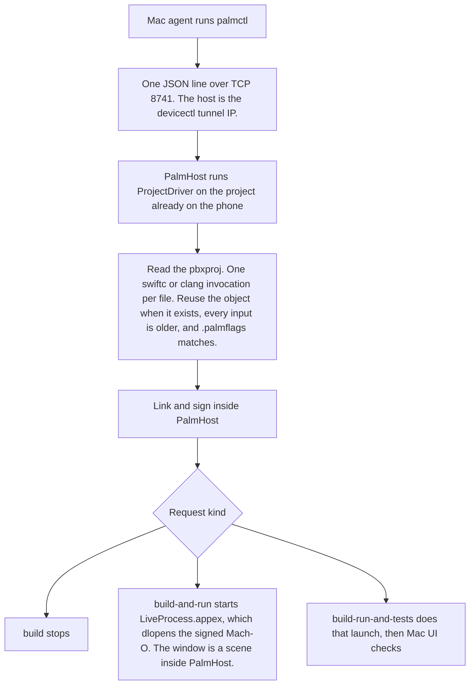

# Palm quickstart

Read this page before driving a build. PalmHost on the iPhone compiles, links, and signs with Nyxian's on-device toolchain. `palmctl` on the Mac sends exactly one request over TCP. A later stage does not run unless that request asked for it.

## How a request runs



`palmctl` does not compile, and ProjectDriver does not call `xcodebuild`. Swift and Clang each run one compiler invocation at a time. Several Swift frontends at once hang on one in-process plugin server. One frontend with several primary files fails because each file has its own `-emit-module-path`. A parallel clang batch segfaulted the host. The `.palmflags` stamp drops the data-container UUID. A rewrite that leaves the bytes unchanged keeps the file's modification time. On-device unit tests are not compiled: `@Test` needs `TestingMacros`, and that plugin is a macOS library. Leave `--repository` off. The phone uses the tree already in `Documents/Projects`.

| Request | Stages | Result |
|---|---|---|
| `build` | pull, compile, link, sign | Logs and success or failure. No launch. |
| `build-and-run` | those, then launch | `running pid <pid> <bundle id> <executable>` |
| `build-run-and-tests` | those, then launch and checks | The same launch line, then Mac UI output |

## Build the client

From this repo:

```bash
swift build --package-path Tools/PalmControl --scratch-path /tmp/palm-control-scratch
```

The binary is `/tmp/palm-control-scratch/out/Products/Debug/palmctl`.

## Before every request

PalmHost is already open. Its screen says it is listening on port 8741.

Read the iPhone tunnel address immediately before the call. It changes.

```bash
xcrun devicectl device info details --device <UDID> --json-output /tmp/palm-device.json
```

Use `result.connectionProperties.tunnelIPAddress` as `TUNNEL_IP`.

```bash
PALMCTL=/tmp/palm-control-scratch/out/Products/Debug/palmctl
```

`--project` is relative to `Documents/Projects` inside PalmHost. GuideAI is `ios/GuideAI.xcodeproj`, target `GuideAI`. `--branch` is required. Do not pass `--repository`. A git checkout on the phone fails with `EPERM`. The phone uses the tree already in `Documents/Projects`.

`Documents/lib/libclang_rt.ios.a` must be present so the link can resolve `___isPlatformVersionAtLeast`.

## build

Stops after sign.

```bash
"$PALMCTL" --host "$TUNNEL_IP" --port 8741 build \
  --branch <branch> \
  --project ios/GuideAI.xcodeproj \
  --target GuideAI
```

Exit 0. The log contains `stage sign` and `signed`. It does not contain `running pid`.

## build-and-run

Same arguments, with `build-and-run` in place of `build`. Exit 0 and a final `running pid` line mean the phone launched the guest. The guest process image is `PalmHost.app/PlugIns/LiveProcess.appex/LiveProcess`. Confirm that pid is still alive and the screen shows the app. The log line is the launch report.

## build-run-and-tests

```bash
export PALM_DEVICE_UDID=<UDID>
export PALM_HOST_BUNDLE_ID=com.onexengineering.PalmHost
export AGENT_DEVICE_IOS_TEAM_ID=<Apple team id>
export AGENT_DEVICE_IOS_BUNDLE_ID=com.example.agentdevice.runner

"$PALMCTL" --host "$TUNNEL_IP" --port 8741 build-run-and-tests \
  --branch <branch> \
  --project ios/GuideAI.xcodeproj \
  --target GuideAI \
  --ui 'wait:Welcome to GuideAI'
```

`--ui` is `ACTION:NAME`. Actions:

| Action | Meaning |
|---|---|
| `wait` | Wait until the visible text is on screen |
| `snapshot` | Interactive snapshot. Pass a scope name |
| `press` | Press a target, then settle |
| `click` | Click a target, then settle |

The guest window is hosted inside PalmHost. `PALM_HOST_BUNDLE_ID=com.onexengineering.PalmHost` makes the Mac check open PalmHost. Opening the guest bundle id foregrounds the real SpringBoard app with the same id.

`agent-device` signs its runner with `AGENT_DEVICE_IOS_TEAM_ID`. Leave `AGENT_DEVICE_IOS_PROVISIONING_PROFILE` unset so Xcode uses Automatic signing. Find the team id with `security find-identity -v -p codesigning`.

## While it runs

Stdout is fully buffered when redirected, so a log file stays empty until `palmctl` exits. An `ESTABLISHED` connection to port 8741 means the session is live. Signing the GuideAI binary moves a large payload and takes a few minutes.

Reinstall PalmHost only when the phone binary itself changed. Unchanged rewritten sources are cache hits: a rewrite that would write the same bytes leaves the file's modification time alone. A reinstall that only changes the container UUID reuses objects that are still on disk.

## Limits

The phone is one sandboxed app. It cannot `fork`, and `posix_spawn` of another executable returns `EPERM`. That rules out a pool of compiler processes, a device-side `git` checkout (`--repository`), and spawning a test executable. LiveProcess is the one extra process, and it is the guest window: PalmHost starts the appex, the appex `dlopen`s the signed Mach-O, and the UI is a FrontBoard scene inside PalmHost. It is not a SpringBoard app and it is not a second compiler.

### One file at a time

Six concurrent `swift::performFrontend` calls share one in-process plugin server. The registry hands back a single plugin list, and the send/wait slot is not locked across waiters, so a parallel Swift batch sits at 0 files until it is killed. The module-cache lock is keyed by pid, so waiters in the same process stall on each other. A parallel Clang batch segfaulted the host (signal 11). Putting several primary files in one frontend with `-enable-batch-mode` fails immediately: each file has its own `-emit-module-path`, module doc path, and source-info path, and the compiler returns no diagnostic when the primary-file list is empty. `-num-threads` is ignored in batch mode. Whole-module `-num-threads` only threads LLVM and rebuilds the module. Swift and Clang therefore compile one file at a time. `--threads` is not a flag.

A full GuideAI compile is one process using most of a core for many minutes. iOS has logged a CPU-usage resource report for PalmHost (`action taken: none`) and has then ended the process around twelve minutes with no exception log. The Mac sees the TCP connection close with no JSON line. Cache hits are what keep a repeat build inside that window.

### Why the screen shows a miss

A hit is the detail line `cached <module> <file>`. `diagnostics ( )` under a filename means that file was compiled. The counter always starts at `0 / total` and counts both. A moving counter is not a cache hit.

The object the cache checks is not `Cache/Palm/<Module>.o`. The Swift driver splits a module into one object per file and writes those under the app container's `tmp` (the link line shows `tmp/<Module>-<hash>.o`). `.palmflags` sits next to that object. iOS may delete `tmp` when PalmHost is not running. After each file in `tmp` compiles, PalmHost copies the object and `.palmflags` to `Documents/Cache/Palm/objects`, which survives the process. The next compile copies those files back into `tmp` before the driver looks for them. The log line is `restored N objects into tmp`. A hit still requires the same compiler arguments. A reinstall can change the driver's object filename because that hash includes the container path, and the restored name then does not match.

A file also misses when the stamp does not match, even if the object is still there. The stamp is a hash of the full `swiftc` argument list plus the modification times of the four repaired SDK interfaces (MapKit, FoundationModels, HealthKit, AVAudioSession). A `build-and-run` after a `build-run-and-tests` misses the app sources because only the test request adds `-enable-testing` and `-emit-module`. A repair that rewrites one of those interfaces changes every file's stamp. The container UUID in a path does not, and a rewrite that leaves the bytes unchanged does not bump the input's modification time.

### No on-device tests

`@Test` and `#expect` expand through `TestingMacros`. The only `libTestingMacros.dylib` Xcode ships is a macOS binary (`LC_BUILD_VERSION` platform `MACOS`). It links the Mac `libswiftCore` and the Mac SwiftSyntax libraries. Copying that file onto the phone does not change the platform load command, and iOS `dyld` rejects it. A small PalmAdd target got past `import Testing` and stopped on the missing plugin. The same is true of `SwiftUIMacros` and `FoundationModelsMacros`: the copies under the iPhoneOS platform directory are still host plugins.

XCTest UI tests launch a SpringBoard app through `XCUIApplication`. The guest window is not that app. Snapshot tests import `SnapshotTesting` and need a GuideAI module from the same compiler; that package is not checked out on the phone. `build-run-and-tests` does not compile a test target. It launches, and the Mac runs `--ui` checks with `agent-device` against the PalmHost window.

### Why the SDK stays on iOS 26.5

The phone OS is iOS 27. The compiler on the phone is Swift 6.4 (CoreCompiler). The iOS 27 SwiftUI interface describes `@State` with `SwiftUIMacros`. That plugin is a macOS dylib, including the file stored at `iPhoneOS.platform/.../host/plugins/libSwiftUIMacros.dylib` (it links `Foundation.framework/Versions/C/Foundation`). The phone cannot load it, so SwiftUI from the iOS 27 SDK does not typecheck on device. The 26.5 slice still describes `@State` as a property wrapper, which Swift 6.4 can load. The Mac's Xcode is already Swift 6.4. A release Xcode 27 is the same compiler and the same host plugins. It does not produce an iOS build of those plugins, and it does not put the 26.5 SwiftUI interface back.

GuideAI is written against iOS 27 APIs, so the 26.5 interfaces are patched in the phone's SDK copy before compile:

- `_MapKit_SwiftUI` uses `MapCamera` and `MapCameraPosition` in `Map` initializers and never declares them. The repair adds those stored types.
- `FoundationModels.Transcript.Entry` stops at the iOS 26 cases. iOS 27 adds `reasoning`, and GuideAI typechecks that case inside `#available(iOS 27, *)`. The repair declares the case and the `Reasoning` struct.
- `AVAudioSession.activateWithOptions` is marked unavailable on iOS in the 26.5 header. The iOS 27 SDK marks it available starting in iOS 27. GuideAI calls it inside `@available(iOS 27, *)`. The repair updates that availability.
- HealthKit in 26.5 has no workout-zone types. iOS 27 adds `preferredWorkoutZoneConfiguration`. The repair declares it.

`@Entry` and `@Generable` are expanded in the source before `swiftc` runs, because those macros are the same class of Mac-only plugin.

The patched interfaces name symbols that the 26.5 SDK binaries do not export. The phone is running iOS 27, so those symbols exist in the system frameworks at runtime. The link passes `-undefined dynamic_lookup` so the 26.5 stubs do not fail the link, and the loader binds the symbols when the guest runs. `___isPlatformVersionAtLeast` is the other missing piece: the compiler emits it for availability checks, and the 26.5 SDK does not ship it. `Documents/lib/libclang_rt.ios.a` (copied from the Mac Clang) is added as `-lclang_rt.ios` when that archive is present.
