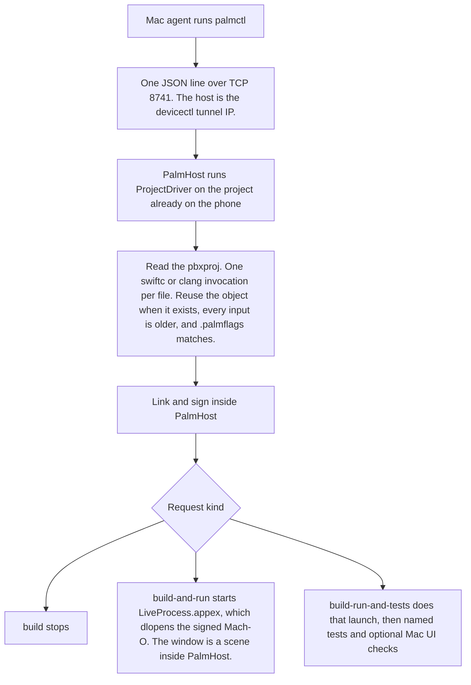

# Palm quickstart

Read this page before driving a build. PalmHost on the iPhone compiles, links, and signs with Nyxian's on-device toolchain. `palmctl` on the Mac sends exactly one request over TCP. A later stage does not run unless that request asked for it.

## How a request runs



`palmctl` does not compile, and ProjectDriver does not call `xcodebuild`. Swift and Clang each run one compiler invocation at a time. Several Swift frontends at once hang on one in-process plugin server. One frontend with several primary files fails because each file has its own `-emit-module-path`. A parallel clang batch segfaulted the host. The `.palmflags` stamp drops the data-container UUID. A rewrite that leaves the bytes unchanged keeps the file's modification time. Only `build-run-and-tests` with named `--test` files stages `Testing.swiftmodule` and emits `GuideAI.swiftmodule` for `@testable import`. A plain `build` does not. Leave `--repository` off. The phone uses the tree already in `Documents/Projects`.

| Request | Stages | Result |
|---|---|---|
| `build` | pull, compile, link, sign | Logs and success or failure. No launch. |
| `build-and-run` | those, then launch | `running pid <pid> <bundle id> <executable>` |
| `build-run-and-tests` | those, then launch and checks | The same launch line, then Mac UI output |

## Build the client

From this repo:

```bash
swift build --package-path Tools/PalmControl --scratch-path /tmp/palm-control-scratch
```

The binary is `/tmp/palm-control-scratch/out/Products/Debug/palmctl`.

## Before every request

PalmHost is already open. Its screen says it is listening on port 8741.

Read the iPhone tunnel address immediately before the call. It changes.

```bash
xcrun devicectl device info details --device <UDID> --json-output /tmp/palm-device.json
```

Use `result.connectionProperties.tunnelIPAddress` as `TUNNEL_IP`.

```bash
PALMCTL=/tmp/palm-control-scratch/out/Products/Debug/palmctl
```

`--project` is relative to `Documents/Projects` inside PalmHost. GuideAI is `ios/GuideAI.xcodeproj`, target `GuideAI`. `--branch` is required. Do not pass `--repository`. A git checkout on the phone fails with `EPERM`. The phone uses the tree already in `Documents/Projects`.

`Documents/lib/libclang_rt.ios.a` must be present so the link can resolve `___isPlatformVersionAtLeast`.

## build

Stops after sign.

```bash
"$PALMCTL" --host "$TUNNEL_IP" --port 8741 build \
  --branch <branch> \
  --project ios/GuideAI.xcodeproj \
  --target GuideAI
```

Exit 0. The log contains `stage sign` and `signed`. It does not contain `running pid`.

## build-and-run

Same arguments, with `build-and-run` in place of `build`. Exit 0 and a final `running pid` line mean the phone launched the guest. The guest process image is `PalmHost.app/PlugIns/LiveProcess.appex/LiveProcess`. Confirm that pid is still alive and the screen shows the app. The log line is the launch report.

## build-run-and-tests

```bash
export PALM_DEVICE_UDID=<UDID>
export PALM_HOST_BUNDLE_ID=com.onexengineering.PalmHost
export AGENT_DEVICE_IOS_TEAM_ID=<Apple team id>
export AGENT_DEVICE_IOS_BUNDLE_ID=com.example.agentdevice.runner

"$PALMCTL" --host "$TUNNEL_IP" --port 8741 build-run-and-tests \
  --branch <branch> \
  --project ios/GuideAI.xcodeproj \
  --target GuideAI \
  --test PartyMinimumSpotsForVotingExactEdgeTests \
  --test StreetSpeedLimitTests \
  --ui 'wait:Welcome to GuideAI'
```

`--ui` is `ACTION:NAME`. Actions:

| Action | Meaning |
|---|---|
| `wait` | Wait until the visible text is on screen |
| `snapshot` | Interactive snapshot. Pass a scope name |
| `press` | Press a target, then settle |
| `click` | Click a target, then settle |

Repeat `--test`, or pass comma-separated names (`--test One,Two`), to compile only those test-target files. The name is the filename with or without the extension. Omit `--test` and the phone compiles every test file. Do not omit it unless you mean that.

GuideAI unit tests that `@testable import GuideAI` do not compile as the on-device test binary. A name that matches no test file, together with `--ui`, skips that binary and still runs the Mac checks against the launch.

The guest window is hosted inside PalmHost. `PALM_HOST_BUNDLE_ID=com.onexengineering.PalmHost` makes the Mac check open PalmHost. Opening the guest bundle id foregrounds the real SpringBoard app with the same id.

`agent-device` signs its runner with `AGENT_DEVICE_IOS_TEAM_ID`. Leave `AGENT_DEVICE_IOS_PROVISIONING_PROFILE` unset so Xcode uses Automatic signing. Find the team id with `security find-identity -v -p codesigning`.

## While it runs

Stdout is fully buffered when redirected, so a log file stays empty until `palmctl` exits. An `ESTABLISHED` connection to port 8741 means the session is live. Signing the GuideAI binary moves a large payload and takes a few minutes.

Reinstall PalmHost only when the phone binary itself changed. Unchanged rewritten sources are cache hits: a rewrite that would write the same bytes leaves the file's modification time alone. A reinstall that only changes the container UUID reuses objects that are still on disk.
